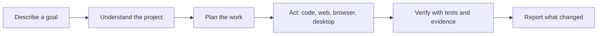
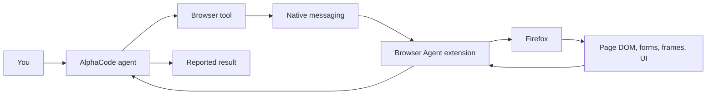
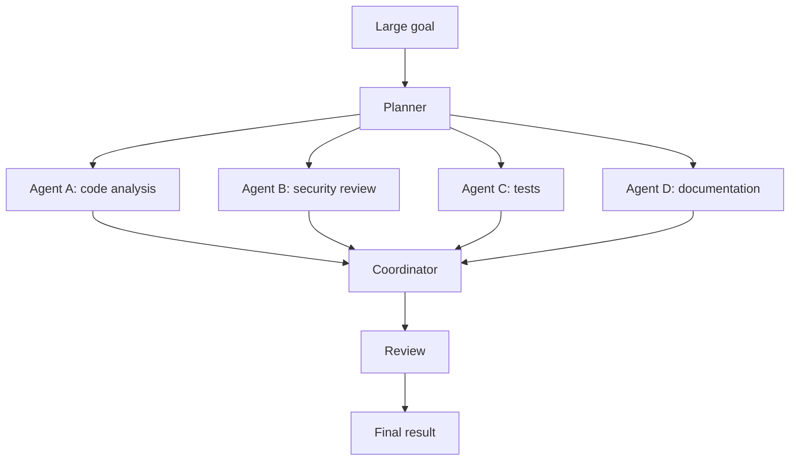

<!--
  MAINTAINER NOTES (invisible on GitHub) — set these in repo Settings for best discoverability:

  Description (<=350 chars):
    Open-source Rust AI coding agent for your terminal. Edits code, runs tests, automates Firefox and desktop apps,
    supports Claude, GPT, Gemini and local models (Ollama, LM Studio), MCP, skills and multi-agent swarms.

  Website: https://alphacli.github.io/

  Topics (add all, GitHub allows 20):
    ai-agent, ai-coding-assistant, coding-agent, rust, cli, terminal, tui, llm, agentic-coding, mcp,
    model-context-protocol, browser-automation, firefox-extension, desktop-automation, claude, openai, gemini,
    ollama, developer-tools, code-generation

  Social preview image: Settings -> Social preview (1280x640 PNG).
-->

<a id="top"></a>

<div align="center">


# AlphaCode: Open-Source AI Coding Agent for Your Terminal

**Built in Rust. Understands your codebase, edits files, runs commands and tests, drives Firefox, controls desktop apps, and verifies its own work.**

Works with **Claude, GPT, Gemini, GitHub Copilot, OpenRouter, and local models** (Ollama, LM Studio). Start free, no API key required.

[](https://github.com/dragonked2/alphacode/stargazers)
[](https://github.com/dragonked2/alphacode/releases)
[](LICENSE)
[](https://github.com/dragonked2/alphacode/issues)


[**Quick start**](#quick-start) · [Demo](#demo) · [Features](#features) · [Docs](docs/) · [Website](https://alphacli.github.io/) · [Releases](https://github.com/dragonked2/alphacode/releases) · [Firefox Agent](https://addons.mozilla.org/en-US/firefox/addon/alphacode-browser-agent/) · [Report a bug](https://github.com/dragonked2/alphacode/issues)

</div>

---

## Install in 30 seconds

**macOS / Linux**

```bash
curl -fsSL https://raw.githubusercontent.com/dragonked2/alphacode/main/scripts/install.sh | bash
```

**Windows (PowerShell)**

```powershell
irm https://raw.githubusercontent.com/dragonked2/alphacode/main/scripts/install.ps1 | iex
```

Then run `alphacode doctor` and `alphacode`. Full walkthrough in the [Quick start](#quick-start).

## Find what you need

| I want to… | Go to |
| --- | --- |
| Try AlphaCode in under two minutes | [Quick start](#quick-start) |
| See it in action | [Demo](#demo) |
| Understand what it can do | [Features](#features) |
| Use Claude, GPT, Gemini, or a local model | [Models and providers](#models-and-providers) |
| Automate a website in Firefox | [Firefox browser automation](#firefox-browser-automation) |
| Control a desktop application | [Desktop automation](#desktop-automation) |
| Run several agents in parallel | [Swarm mode](#swarm-mode) |
| Fix an install or setup problem | [Troubleshooting](#troubleshooting) |
| Remove AlphaCode cleanly | [Uninstall](#uninstall) |
| Help improve the project | [Contributing](#contributing) |

<details>
<summary><strong>Full table of contents</strong></summary>

- [What is AlphaCode?](#what-is-alphacode)
- [Demo](#demo)
- [Quick start](#quick-start)
- [Features](#features)
- [Firefox browser automation](#firefox-browser-automation)
- [Desktop automation](#desktop-automation)
- [Swarm mode](#swarm-mode)
- [Sessions and memory](#sessions-and-memory)
- [Models and providers](#models-and-providers)
- [Built-in tools, skills, and MCP](#built-in-tools-skills-and-mcp)
- [Security testing and bug bounty workflows](#security-testing-and-bug-bounty-workflows)
- [Safety and reliability](#safety-and-reliability)
- [Benchmarks](#benchmarks)
- [Installation options](#installation-options)
- [Configuration](#configuration)
- [Commands and shortcuts](#commands-and-shortcuts)
- [Troubleshooting](#troubleshooting)
- [Uninstall](#uninstall)
- [FAQ](#faq)
- [Use cases](#use-cases)
- [Project links](#documentation-and-project-links)
- [Security reporting](#security-reporting)
- [Contributing](#contributing)

</details>

---

## What is AlphaCode?

**AlphaCode is an open-source AI coding agent written in Rust that runs in your terminal.** Instead of only suggesting code in a chat window, it works directly in your development environment. It can inspect a repository, plan a task, edit files, run commands and tests, search the web, operate a real Firefox session, interact with native desktop applications, and report what it verified.

It belongs to the same category as terminal coding agents such as Claude Code, Codex CLI, Aider, and OpenCode, with a focus on a small memory footprint, real-browser and desktop automation, and model freedom.



The workflow is **understand, plan, execute, observe, verify**, and it ends with a report of what changed, what was checked, and what remains.

### Why developers choose AlphaCode

| | |
| --- | --- |
| **Lightweight** | A native Rust binary with a small memory footprint (see [Benchmarks](#benchmarks)) |
| **Model-agnostic** | Claude, GPT, Gemini, Copilot, Cursor, Bedrock, Azure, OpenRouter, or any OpenAI-compatible endpoint |
| **Beyond the editor** | Drives a real Firefox session and native desktop apps, not only files and shells |
| **Verifies its work** | Runs tests, reviews its own diff, and reports evidence |
| **Resumable** | Sessions survive terminal restarts, crashes, and dropped SSH connections |
| **Extensible** | Skills, MCP servers, hooks, and multi-agent swarms |
| **Free to start** | A built-in free AI lane works without an API key |
| **Open source** | MIT licensed |

### Example tasks

Use plain English or precise technical instructions.

<details open>
<summary><strong>Debug and fix a regression</strong></summary>

```text
Find why the app crashes when users upload a PDF.
Fix the root cause, add a regression test, run the relevant tests, and review the final diff.
```

</details>

<details open>
<summary><strong>Test a web application</strong></summary>

```text
Open the application in Firefox, go to the account settings page,
check that the new feature is visible, and capture a screenshot.
```

</details>

<details open>
<summary><strong>Investigate a security issue</strong></summary>

```text
Trace untrusted input to sensitive operations, validate likely findings,
and report which issues are reproducible in this authorized test environment.
```

</details>

Advanced workflows can combine multiple agents, reusable skills, and MCP-connected tools.

## Demo

A walkthrough from installation to a first task. Click the image to open the SVG at full size.

<p align="center">
  <a href="./alphacode-demo.svg" title="Open the AlphaCode demo at full size">
    
  </a>
</p>

<p align="center"><sub>If the image does not render in a third-party viewer, <a href="./alphacode-demo.svg">open the SVG directly</a>.</sub></p>

<div align="right"><a href="#top">Back to top</a></div>

## Quick start

Four steps from zero to your first task.

### 1. Install

Use the one-line installer from [Install in 30 seconds](#install-in-30-seconds).

> [!TIP]
> In security-conscious environments, download and inspect the installer before running it. See [Installation options](#installation-options) for version pinning, PATH control, and source builds.

> [!IMPORTANT]
> On Windows, run AlphaCode from **Windows Terminal or PowerShell**. Do not double-click `alphacode.exe`; the temporary console closes as soon as the process exits.

### 2. Check your setup and launch

```bash
alphacode doctor
alphacode
```

`alphacode doctor` checks your environment and reports common setup issues. The built-in free AI lane lets you start without configuring an API key. Connected providers may require their own credentials and may incur charges.

The first launch includes a short onboarding flow for preferences such as telemetry, model defaults, and key bindings. Press `Esc` to skip any step.

### 3. Give it a task

Type a request in the terminal UI:

```text
Explain this project and identify its main entry points.
```

Or ask it to find and repair a bug:

```text
Find the highest-impact bug, fix it with the smallest reasonable change, and run the relevant tests.
```

To run a task without opening the interactive UI:

```bash
alphacode run "fix the failing test"
```

### 4. Optional: connect Firefox

Install the [AlphaCode Browser Agent extension](https://addons.mozilla.org/en-US/firefox/addon/alphacode-browser-agent/), then run:

```bash
alphacode browser setup
alphacode browser status
```

The status command reports whether the browser bridge is available and responding.

<div align="right"><a href="#top">Back to top</a></div>

## Features

| Capability | What it does |
| --- | --- |
| **AI coding agent** | Understands natural-language tasks, plans multi-step work, edits code, and checks results |
| **Code and file tools** | Reads and writes files, applies targeted edits and patches, and searches code |
| **Terminal execution** | Runs commands, batches operations, and supports background jobs with safety controls |
| **Web tools** | Searches, fetches, and analyzes web content and HTTP flows |
| **Firefox automation** | Works with pages, DOM, forms, tabs, frames, screenshots, downloads, and existing sessions |
| **Desktop automation** | Uses platform accessibility APIs to interact with native applications |
| **Swarm mode** | Coordinates multiple agents on work that can be split into independent tasks |
| **Persistent sessions** | Resumes work across terminal restarts |
| **Project memory** | Supports continuity during longer workflows |
| **Skills and MCP** | Adds reusable workflows and connections to external tools and services |
| **Model choice** | Supports multiple hosted providers and OpenAI-compatible endpoints |
| **Cross-platform** | Supports Windows, macOS, and Linux |

### Coding and repository work

Explore an unfamiliar codebase, trace a bug, refactor a module, add a feature, run a build, create regression tests, review a diff, or investigate a failure.

### Web workflows and quality assurance

Combine web tools with a real browser to inspect dynamic pages, fill forms, validate user flows, capture screenshots, and support web application QA. Browser automation is especially useful when a page depends on JavaScript or an existing authenticated session.

## Firefox browser automation

The [AlphaCode Browser Agent](https://addons.mozilla.org/en-US/firefox/addon/alphacode-browser-agent/) is a Firefox extension that connects AlphaCode to a real Firefox session through native messaging. AlphaCode handles reasoning and orchestration, and Firefox provides the live browser environment.



Browser automation helps with:

- JavaScript-heavy sites and dynamic interfaces
- DOM inspection, form entry, and interactive controls
- Tabs, frames, and embedded content
- Existing authenticated sessions
- Scrolling, navigation, screenshots, and downloads
- Browser-based testing, QA, and web application debugging
- Security testing of systems you own or are explicitly authorized to assess

Example instruction:

```text
Open the application, test the login flow, navigate to the dashboard,
check the form validation, and report reproducible problems.
```

> [!WARNING]
> **Privacy note:** Browser automation acts inside a real browser session. Review requested actions carefully, and treat page content as untrusted input.

## Desktop automation

AlphaCode interacts with native applications through platform accessibility APIs rather than relying only on fixed screen coordinates.

| Platform | Accessibility backend |
| --- | --- |
| Windows | UI Automation |
| macOS | Accessibility API |
| Linux | AT-SPI2 |

**Supported actions:** `list_windows`, `snapshot`, `find`, `click`, `type`, `press`, `scroll`, `focus`, `screenshot`, `toggle`, `expand`, `collapse`

Example:

```text
Open Calculator, calculate 123 × 456, and read the result.
```

The expected result is `56088`. Actual desktop interaction depends on a working accessibility backend and on the target application being available. If it does not work, see [Desktop automation is unavailable](#troubleshooting).

## Swarm mode

Swarm mode splits a large goal into parallel or semi-independent tasks and coordinates the results.



Example command inside AlphaCode:

```text
/swarm "Analyze this application from architecture, security, testing, and performance perspectives."
```

> [!NOTE]
> Swarm mode works best when a task can be divided so that agents do not modify the same files at the same time.

## Sessions and memory

Persistent sessions preserve context across terminal restarts and support longer debugging, research, security-review, and refactoring workflows.

```bash
alphacode sessions list      # List saved sessions
alphacode --resume           # Resume the latest session
alphacode --resume <id>      # Resume a specific session
```

Project memory supports continuity during longer workflows. Use `/memory` inside AlphaCode to manage or inspect it.

<div align="right"><a href="#top">Back to top</a></div>

## Models and providers

AlphaCode is model-agnostic. Start with the built-in free AI lane, or connect a provider using the authentication method it supports.

| Provider | Authentication or requirement | Notes |
| --- | --- | --- |
| Built-in free AI lane | Built in | Designed to work without an API key |
| Anthropic (Claude) | OAuth or API key | Provider support is built in |
| OpenAI (GPT and o-series) | OAuth, API key, or supported sign-in flow | Reasoning, vision, and tools depend on the selected model and flow |
| Google Gemini | OAuth or API key | |
| GitHub Copilot | OAuth | Requires an eligible account or subscription |
| Cursor | OAuth | Reuses a Cursor session where supported |
| AWS Bedrock | AWS credentials | Build with `--features bedrock` when required |
| Azure | Azure AD or API key | Build with `--features azure-auth` when required |
| OpenRouter | API key | Access to a wide range of models |
| OpenAI-compatible endpoint | Endpoint-specific key or configuration | Add with `alphacode provider add <name>` |

### Provider and model commands

```bash
alphacode login                    # Open the provider sign-in flow
alphacode login --provider openai  # Sign in with a specific provider
alphacode provider list            # List configured providers
alphacode provider add <name>      # Add an OpenAI-compatible endpoint
alphacode provider current         # Show the active provider and model
alphacode model list               # List available models
alphacode model use <model>        # Select a model
```

In the terminal UI, type `/model` to open the model and provider selector.

### Local models (Ollama, LM Studio, and other OpenAI-compatible servers)

AlphaCode uses the context window reported by the server when available. For local models with up to 32K context, it uses a shorter task prompt and a bounded set of relevant tool schemas. Simple greetings may not need tool schemas at all.

> [!NOTE]
> This reduces prompt overhead but does **not** increase the model server's configured context window. Set the context length in the server itself, and leave enough room for output.

### Authentication notes

Many providers use environment variables such as `ANTHROPIC_API_KEY` or `OPENAI_API_KEY`. You can also run `alphacode login` from your shell, or `/login` inside AlphaCode.

**OpenAI Codex OAuth:** AlphaCode uses a local callback at `http://localhost:1455/auth/callback` during sign-in. Make sure port `1455` is free. If the login flow times out, check whether another process is listening on that port, then retry `/login`.

See the [documentation](docs/) for provider-specific setup and troubleshooting.

## Built-in tools, skills, and MCP

AlphaCode includes **40+ tools**. Names and availability can vary with the build and enabled features.

| Category | Examples |
| --- | --- |
| **Files** | `read`, `write`, `edit`, `multiedit`, `patch`, `apply_patch`, `ls` |
| **Search** | `alphagrep`, `session_search`, `conversation_search` |
| **Execution** | `bash`, `batch`, `bg` |
| **Web and browser** | `browser`, `webfetch`, `websearch`, `scrapling`, `httpflow`, `open` |
| **Desktop** | `desktop`, `macos_computer_use` |
| **Agent workflow** | `memory`, `initiative`, `todo`, `plan`, `swarm` |
| **Utilities** | `doctor`, `self_improve`, `selfdev`, `cron`, `schedule`, `jwt`, `clipboard`, `side_panel`, `discover_tools` |

### Skills

Skills add reusable, specialized workflows without changing the core agent. Browse them with `/skills`. Examples from the project include `/bugbounty`, `/meme-coin-audit`, and `/frontend-design`.

### Model Context Protocol (MCP)

MCP support lets you connect external tools, services, and custom integrations. See the project documentation for the configuration each server requires.

## Security testing and bug bounty workflows

Code analysis, HTTP tools, browser automation, terminal execution, memory, and multi-agent workflows can support repeatable application-security reviews.

```text
Review this API for insecure direct object references and provide reproducible evidence.
```

```text
Trace this parameter through the application and determine whether it reaches a dangerous sink.
```

```text
Use the authorized test environment in Firefox to test input validation and document reproducible findings.
```

> [!CAUTION]
> **Authorization required.** Test only systems you own or are explicitly authorized to assess.

## Safety and reliability

An agent that can change files, execute commands, and operate applications needs careful oversight. The project describes these safeguards:

- Blocking certain destructive filesystem and device targets
- Permission prompts for risky actions
- Safety controls for shell execution
- SSRF and credential-leak heuristics for network operations
- Tracking interrupted sessions rather than silently losing them
- Timeouts and emergency-stop handling for desktop automation
- Input-state cleanup when operations fail
- Treating browser and desktop content as potentially untrusted

> [!WARNING]
> These safeguards reduce risk; they do not guarantee that every action is safe or correct. **Review important diffs before merging or deploying.** Use `/diff` to inspect changes.

### Session resilience

Sessions are resumable and designed to recover from interruptions. Crashes, signals, or dropped SSH connections can mark a session as `Crashed` and provide a resume command. Transcripts are persisted to disk rather than kept entirely in process memory.

### Coding-quality contract

For code-changing tasks, AlphaCode is instructed to follow these guardrails:

1. **Small changes:** avoid bundling unrelated edits, and report adjacent issues separately.
2. **Regression awareness:** rerun relevant tests and investigate new warnings or failures.
3. **Self-review:** check that the objective is covered, evidence is available, regressions are considered, the diff is scoped, and edge cases are reviewed.
4. **Structured reporting:** state what changed, what was verified, and what remains.

The agent's instructions are not a substitute for independently reviewing the implementation and test results.

<div align="right"><a href="#top">Back to top</a></div>

## Benchmarks

AlphaCode is written in Rust and designed to keep runtime overhead modest.

> [!NOTE]
> These are **historical measurements**, not a current independent benchmark or a guarantee of performance on every machine or workload. Competing tools change quickly, so re-measure before drawing conclusions.

### Memory usage: one active session

| Tool | RAM | Relative to AlphaCode |
| --- | ---: | ---: |
| **AlphaCode** | **27.8 MB** | **1.0×** |
| Codex CLI | 140.0 MB | 5.0× |
| pi | 144.4 MB | 5.2× |
| Cursor Agent | 214.9 MB | 7.7× |
| Antigravity CLI | 243.7 MB | 8.8× |
| GitHub Copilot CLI | 333.3 MB | 12.0× |
| OpenCode | 371.5 MB | 13.4× |
| Claude Code | 386.6 MB | 13.9× |

### Memory usage: ten concurrent sessions

| Tool | RAM | Relative to AlphaCode |
| --- | ---: | ---: |
| **AlphaCode** | **117.0 MB** | **1.0×** |
| Codex CLI | 334.8 MB | 2.9× |
| pi | 833.0 MB | 7.1× |
| Antigravity CLI | 1,021.2 MB | 8.7× |
| Cursor Agent | 1,632.4 MB | 14.0× |
| GitHub Copilot CLI | 1,756.5 MB | 15.0× |
| Claude Code | 2,300.6 MB | 19.7× |
| OpenCode | 3,237.2 MB | 27.7× |

### Reproducing a comparison

Compare tools under the same conditions and record:

- AlphaCode version or commit
- OS, CPU, and RAM
- Build profile and enabled features
- Number of concurrent sessions
- Measurement method and warm/cold state
- The exact workload

## Installation options

The quick-start commands use the latest installer. This section covers optional flags and source builds. Inspect remote scripts before running them if your environment requires manual review.

### Windows

```powershell
irm https://raw.githubusercontent.com/dragonked2/alphacode/main/scripts/install.ps1 | iex
```

The installer:

- detects your CPU architecture and downloads a release;
- verifies the release's SHA-256 checksum;
- installs `alphacode.exe` under `%LOCALAPPDATA%\Programs\alphacode\bin\`;
- adds that folder to the current user's `Path` and activates it in the current shell;
- needs **no administrator rights** for the user-level install.

<details>
<summary><strong>How the Windows PATH change works</strong></summary>

The installer writes the user-level `HKCU\Environment\Path` rather than the machine-wide path. It appends its entry, avoids duplicates on re-run, and broadcasts `WM_SETTINGCHANGE` so new terminals can pick up the change. Existing shell-only PATH entries are preserved.

</details>

To pass installer parameters, load the script as a script block instead of piping directly to `iex`:

| Parameter | Purpose |
| --- | --- |
| `-Version vX.Y.Z` | Pin a release version |
| `-FromSource` | Build from source instead of downloading a release |
| `-PathDryRun` | Preview the PATH change without writing it |
| `-NoPath` | Do not modify PATH |
| `-Prefix <dir>` | Choose a custom installation prefix |

<details>
<summary><strong>Windows examples with parameters</strong></summary>

```powershell
$installer = [scriptblock]::Create((irm https://raw.githubusercontent.com/dragonked2/alphacode/main/scripts/install.ps1))

# Pin a release version
& $installer -Version vX.Y.Z

# Build from source instead of downloading a release
& $installer -FromSource

# Preview the PATH change without writing it
& $installer -PathDryRun

# Do not modify PATH
& $installer -NoPath

# Choose a custom installation prefix
& $installer -Prefix "$env:LOCALAPPDATA\Programs\alphacode"
```

Run one parameter at a time, or combine them in a single call such as `& $installer -Version vX.Y.Z -NoPath`. Replace `vX.Y.Z` with a real tag from the [releases page](https://github.com/dragonked2/alphacode/releases).

</details>

### macOS and Linux

```bash
curl -fsSL https://raw.githubusercontent.com/dragonked2/alphacode/main/scripts/install.sh | bash
```

The installer downloads a release, verifies its checksum, installs `alphacode` under `~/.local/bin`, and updates a supported shell profile. It is documented as supporting bash, zsh, fish, nushell, csh, and ksh, and is safe to re-run without duplicating its profile entry.

| Option | Purpose |
| --- | --- |
| `--version vX.Y.Z` | Pin a release version |
| `--no-path` | Do not modify PATH |
| `--link` | Link into `/usr/local/bin` |
| `--prefix <dir>` | Choose a custom installation prefix |

<details>
<summary><strong>macOS / Linux examples with options</strong></summary>

```bash
# Pin a release version
curl -fsSL https://raw.githubusercontent.com/dragonked2/alphacode/main/scripts/install.sh | bash -s -- --version vX.Y.Z

# Do not modify PATH
curl -fsSL https://raw.githubusercontent.com/dragonked2/alphacode/main/scripts/install.sh | bash -s -- --no-path

# Link into /usr/local/bin
curl -fsSL https://raw.githubusercontent.com/dragonked2/alphacode/main/scripts/install.sh | bash -s -- --link

# Choose a custom installation prefix
curl -fsSL https://raw.githubusercontent.com/dragonked2/alphacode/main/scripts/install.sh | bash -s -- --prefix ~/.local
```

</details>

### Verify installation

```bash
alphacode --version
alphacode doctor
```

On Windows you can also check command resolution:

```powershell
Get-Command alphacode
```

### Build from source

```bash
git clone https://github.com/dragonked2/alphacode.git
cd alphacode
cargo build --release
./target/release/alphacode --version
```

The project pins Rust edition 2024 in [`rust-toolchain.toml`](rust-toolchain.toml), and a C toolchain for your platform is also required.

The default build omits some heavier optional stacks. Enable them when you need them:

```bash
cargo build --release --features bedrock,embeddings,pdf,renderer
```

For Azure AD authentication, add `azure-auth`, for example `--features bedrock,azure-auth,embeddings,pdf,renderer`.

### Update

```bash
alphacode update
```

## Configuration

AlphaCode stores its configuration, sessions, and logs outside the project directory.

| OS | Configuration | Sessions | Logs |
| --- | --- | --- | --- |
| Linux | `~/.config/alphacode/` | `~/.local/share/alphacode/sessions/` | `~/.local/share/alphacode/logs/` |
| macOS | `~/Library/Application Support/alphacode/` | `~/Library/Application Support/alphacode/` | `~/Library/Application Support/alphacode/` |
| Windows | `%APPDATA%\alphacode\` | `%LOCALAPPDATA%\alphacode\sessions\` | `%LOCALAPPDATA%\alphacode\logs\` |

A health monitor records memory use, slow operations, error rates, and subsystem liveness in `health.json`.

| Section | Purpose |
| --- | --- |
| `[provider]` | Provider and model selection |
| `[features]` | Feature flags |
| `[display]` | UI preferences |
| `[websearch]` | Search settings |
| `[agents]` | Agent and swarm settings |
| `[hooks]` | Lifecycle hooks |
| `[safety]` | Notifications and safety controls |
| `[compaction]` | Context management |
| `[power]` | Power-management behavior |
| `[gateway]` | Remote gateway settings |

See [`docs/configuration.md`](docs/configuration.md) for the full reference.

<div align="right"><a href="#top">Back to top</a></div>

## Commands and shortcuts

### CLI commands

| Command | Purpose |
| --- | --- |
| `alphacode` | Launch the interactive terminal UI |
| `alphacode doctor` | Check setup and common environment issues |
| `alphacode login` | Authenticate with a provider |
| `alphacode run "<task>"` | Run a task non-interactively |
| `alphacode repl` | Start the simple REPL without the TUI |
| `alphacode provider add <name>` | Add an OpenAI-compatible endpoint |
| `alphacode provider list` | List configured providers |
| `alphacode provider current` | Show the active provider and model |
| `alphacode model list` | List available models |
| `alphacode model use <model>` | Select a model |
| `alphacode browser setup` | Configure the browser bridge |
| `alphacode browser status` | Check browser connectivity |
| `alphacode sessions list` | List saved sessions |
| `alphacode --resume [id]` | Resume the latest session, or a specific one |
| `alphacode --version` | Show the installed version |
| `alphacode update` | Update AlphaCode |

### Slash commands

| Command | Purpose |
| --- | --- |
| `/help` | Show help |
| `/login` | Sign in to a provider from inside AlphaCode |
| `/agents` | Manage agents |
| `/swarm "<goal>"` | Split a large goal across multiple agents |
| `/compact` | Compact context |
| `/memory` | Manage or inspect project memory |
| `/skills` | Browse skills |
| `/diff` | Review changes |
| `/poke` | Trigger an automatic follow-up |
| `/screenshot-mode` | Configure screenshot capture |
| `/exit` | Exit while preserving the session |

### Keyboard shortcuts

| Shortcut | Action |
| --- | --- |
| `F1` | Show shortcut reference |
| `Ctrl+T` | Toggle queue mode |
| `Ctrl+Y` | Accept the suggested fallback model after an error |
| `Ctrl+C` | Interrupt the current turn (quit when idle) |
| `Esc` | Close a dialog or go back |
| `/model` | Open the model and provider picker |
| `Shift+Tab` | Cycle favorited models |

## Troubleshooting

Start with `alphacode doctor`, which catches most setup problems. Then find your symptom below.

<details>
<summary><strong><code>alphacode</code> command not found</strong></summary>

Open a **new** terminal first so it can read the updated PATH. If it is still not found, confirm the install location and PATH settings.

**bash:**

```bash
echo 'export PATH="$HOME/.local/bin:$PATH"' >> ~/.bashrc
source ~/.bashrc
```

**zsh (default on modern macOS):**

```bash
echo 'export PATH="$HOME/.local/bin:$PATH"' >> ~/.zshrc
source ~/.zshrc
```

**fish:**

```fish
fish_add_path $HOME/.local/bin
```

**Windows:** re-run the installer (unless you used `-NoPath`), or add `%LOCALAPPDATA%\Programs\alphacode\bin` to your user PATH and open a new PowerShell window.

</details>

<details>
<summary><strong>The Firefox Browser Agent is not responding</strong></summary>

```bash
alphacode browser status
alphacode browser setup
```

Then confirm that the [AlphaCode Browser Agent extension](https://addons.mozilla.org/en-US/firefox/addon/alphacode-browser-agent/) is installed and enabled in Firefox.

</details>

<details>
<summary><strong>Desktop automation is unavailable</strong></summary>

- **macOS:** grant Accessibility and Screen Recording permissions under *System Settings → Privacy & Security*.
- **Linux:** check that AT-SPI2 is available.
- **Windows:** elevated applications may require AlphaCode to run with appropriate privileges.

</details>

<details>
<summary><strong>OpenAI login times out</strong></summary>

Port `1455` on localhost may already be in use. Check for another process listening on that port, stop it if appropriate, and retry `/login`. See the [documentation](docs/) for provider-specific steps.

</details>

<details>
<summary><strong>The demo image does not display</strong></summary>

The demo asset is `alphacode-demo.svg`, not a video. Confirm that the file is committed at the repository root and that its filename capitalization matches the link. You can also [open the SVG directly](./alphacode-demo.svg).

</details>

Still stuck? Run `alphacode doctor` and [open an issue](https://github.com/dragonked2/alphacode/issues) with reproducible steps and relevant logs.

> [!WARNING]
> Remove secrets and tokens from diagnostic output before sharing it.

## Uninstall

Close active AlphaCode sessions first. On Windows, a running `alphacode.exe` cannot be removed until its process exits.

### Recommended: uninstall script

**macOS / Linux**

```bash
curl -fsSL https://raw.githubusercontent.com/dragonked2/alphacode/main/scripts/uninstall.sh | bash
```

**Windows (PowerShell)**

```powershell
irm https://raw.githubusercontent.com/dragonked2/alphacode/main/scripts/uninstall.ps1 | iex
```

By default the scripts remove the installed executable and leave your configuration and saved sessions in place.

### Remove all local data

> [!CAUTION]
> Purging is **permanent**. It may delete configuration, saved sessions, logs, and locally stored sign-in data. Back up anything you need first.

**macOS / Linux**

```bash
curl -fsSL https://raw.githubusercontent.com/dragonked2/alphacode/main/scripts/uninstall.sh | bash -s -- --purge
```

Equivalent environment-variable form:

```bash
curl -fsSL https://raw.githubusercontent.com/dragonked2/alphacode/main/scripts/uninstall.sh | ALPHACODE_PURGE=1 bash
```

**Windows (PowerShell)**

```powershell
& ([scriptblock]::Create((irm https://raw.githubusercontent.com/dragonked2/alphacode/main/scripts/uninstall.ps1))) -Purge
```

### Manual uninstall

| Item | Linux | macOS | Windows |
| --- | --- | --- | --- |
| Binary | `~/.local/bin/alphacode` | `~/.local/bin/alphacode` | `%LOCALAPPDATA%\Programs\alphacode\` |
| Config | `~/.config/alphacode/` | `~/Library/Application Support/alphacode/` | `%APPDATA%\alphacode\` |
| Sessions | `~/.local/share/alphacode/sessions/` | Application Support directory | `%LOCALAPPDATA%\alphacode\sessions\` |
| Logs | `~/.local/share/alphacode/logs/` | Application Support directory | `%LOCALAPPDATA%\alphacode\logs\` |

Remove only the binary to keep your settings and sessions. Delete the data directories only if you intend to remove local state as well.

**Linux**

```bash
rm -f ~/.local/bin/alphacode
# Optional: remove configuration, sessions, and logs
rm -rf ~/.config/alphacode ~/.local/share/alphacode
```

**macOS**

```bash
rm -f ~/.local/bin/alphacode
# Optional: remove configuration and local data
rm -rf "$HOME/Library/Application Support/alphacode"
```

**Windows (PowerShell)**

```powershell
Remove-Item -Recurse -Force "$env:LOCALAPPDATA\Programs\alphacode"
# Optional: remove configuration and local data
Remove-Item -Recurse -Force "$env:APPDATA\alphacode", "$env:LOCALAPPDATA\alphacode"
```

If you installed with `cargo install --path .`, run `cargo uninstall alphacode`. If you built from a clone, delete the cloned repository separately.

### Additional cleanup

- **PATH entry:** remove the AlphaCode entry from your shell profile or user PATH. On Windows, use the Environment Variables dialog so `%USERPROFILE%`-style entries are not expanded unintentionally.
- **Firefox extension:** open `about:addons`, select *AlphaCode Browser Agent*, and choose **Remove**.
- **Native messaging registration:** if you ran `alphacode browser setup`, remove the AlphaCode registration after checking its exact name:
  - Linux: files in `~/.mozilla/native-messaging-hosts/`
  - macOS: files in `~/Library/Application Support/Mozilla/NativeMessagingHosts/`
  - Windows: a **registry key** under `HKCU\Software\Mozilla\NativeMessagingHosts` (remove it with Registry Editor or `Remove-Item -Path "HKCU:\Software\Mozilla\NativeMessagingHosts\<name>"`)
- **Credentials:** remove exported `*_API_KEY` variables, and revoke provider API keys or OAuth grants you no longer need.
- **Scheduled jobs:** remove any recurring tasks created with `cron` or `schedule` **before** deleting local application data.

### Verify removal

```bash
command -v alphacode
```

On Windows:

```powershell
Get-Command alphacode -ErrorAction SilentlyContinue
```

If the shell still finds the command, open a new terminal or refresh the shell's command cache.

<div align="right"><a href="#top">Back to top</a></div>

## FAQ

<details>
<summary><strong>Is AlphaCode free?</strong></summary>

AlphaCode is open source under the MIT License and includes a built-in free AI lane for getting started without an API key. Third-party model providers may impose their own usage limits, terms, or charges.

</details>

<details>
<summary><strong>Do I need an API key?</strong></summary>

Not to get started with the built-in free AI lane. Other providers may require sign-in, API keys, or additional configuration.

</details>

<details>
<summary><strong>What is the best way to try AlphaCode?</strong></summary>

Install it, run `alphacode doctor`, launch `alphacode` in a project folder, and ask it to explain the project. Then try a small, low-risk fix such as a failing test.

</details>

<details>
<summary><strong>Which operating systems are supported?</strong></summary>

Windows, macOS, and Linux. Individual features and desktop automation backends vary by operating system and build configuration.

</details>

<details>
<summary><strong>Can AlphaCode use Claude, GPT, Gemini, or local models like Ollama?</strong></summary>

Yes. It supports multiple providers and any OpenAI-compatible endpoint, including local servers such as Ollama and LM Studio. Authentication methods and model capabilities depend on your selected provider and model. See [Models and providers](#models-and-providers).

</details>

<details>
<summary><strong>Can AlphaCode automate websites?</strong></summary>

Yes. The Firefox integration supports real-browser workflows such as navigation, DOM and form interaction, tabs, frames, screenshots, and downloads. It requires a correctly configured browser bridge and extension.

</details>

<details>
<summary><strong>Can AlphaCode control desktop applications?</strong></summary>

Yes, through platform accessibility APIs on Windows, macOS, and Linux. Required permissions and the level of support depend on the operating system and target application.

</details>

<details>
<summary><strong>Is AlphaCode suitable for beginners?</strong></summary>

You can start with plain-English instructions. Review code changes and actions carefully, particularly before deploying software or running sensitive operations.

</details>

<details>
<summary><strong>Can I use AlphaCode for security testing?</strong></summary>

Yes, for authorized security research and testing. Only assess systems you own or have explicit permission to test. See [Security testing and bug bounty workflows](#security-testing-and-bug-bounty-workflows).

</details>

<details>
<summary><strong>Does AlphaCode remember previous work?</strong></summary>

Persistent sessions and project memory support longer workflows across terminal restarts. Use `alphacode sessions list` and `alphacode --resume` to continue saved work.

</details>

<details>
<summary><strong>How do I update AlphaCode?</strong></summary>

Run `alphacode update`.

</details>

## Use cases

| Area | Examples |
| --- | --- |
| **Software development** | Debugging, refactoring, feature work, test generation, code review, repository exploration, documentation, build troubleshooting |
| **Web development** | Frontend and backend changes, API testing, browser-based testing, UI validation |
| **Application security** | Authorized penetration testing, bug bounty work, code audits, HTTP analysis, reproducible vulnerability reports |
| **QA and testing** | Regression testing, form validation, UI verification, reproducibility checks |
| **Automation** | Browser workflows, desktop applications, repetitive tasks, supported data-collection workflows |

## Documentation and project links

- [Documentation index](docs/)
- [Configuration reference](docs/configuration.md)
- [Changelog](CHANGELOG.md)
- [Contributing guide](CONTRIBUTING.md)
- [Code of conduct](CODE_OF_CONDUCT.md)
- [Security policy](SECURITY.md)
- [Official website](https://alphacli.github.io/)
- [GitHub releases](https://github.com/dragonked2/alphacode/releases)
- [Firefox Browser Agent](https://addons.mozilla.org/en-US/firefox/addon/alphacode-browser-agent/)

## Security reporting

Report vulnerabilities **privately** using the instructions in [`SECURITY.md`](SECURITY.md). For issues specific to the Firefox extension, Mozilla's add-on reporting tools may also be appropriate.

## Contributing

Issues, reproducible bug reports, documentation updates, and pull requests are welcome.

```bash
git clone https://github.com/dragonked2/alphacode.git
cd alphacode
cargo build --release
cargo test --lib
cargo clippy --lib -- -D warnings
```

Before opening a pull request, check that:

- [ ] The release build succeeds
- [ ] Relevant tests pass
- [ ] New behavior includes tests where appropriate
- [ ] Clippy passes
- [ ] Public APIs are documented
- [ ] New dependencies are justified
- [ ] User-visible changes are documented

Read [`CONTRIBUTING.md`](CONTRIBUTING.md) before submitting a change.

## Support AlphaCode

If AlphaCode saves you time, star the repository, report reproducible bugs, suggest improvements, improve the docs, test releases, or contribute code. Sharing it with a teammate helps too.

<div align="center">

[](https://github.com/dragonked2/alphacode)
[](https://addons.mozilla.org/en-US/firefox/addon/alphacode-browser-agent/)
[](https://www.buymeacoffee.com/dragonked2)

<sub>Built with Rust by <a href="https://github.com/dragonked2">Ali Essam</a> · MIT licensed · Open source</sub>

</div>
