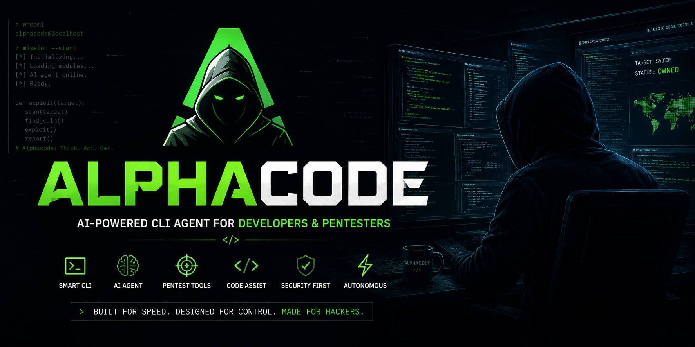
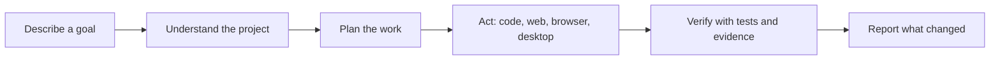
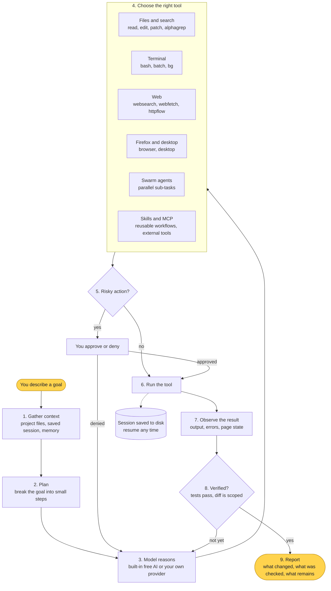
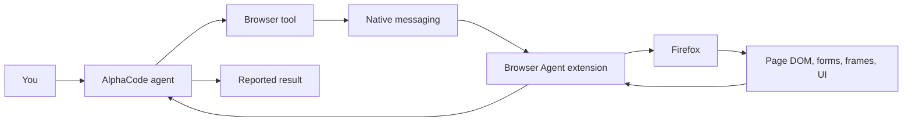
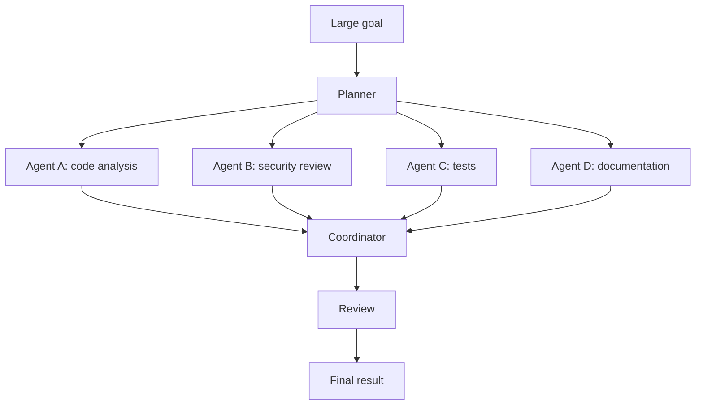

<a id="readme-top"></a>

<div align="center">

<a href="https://alphacli.github.io/">
  
</a>

<br>

# AlphaCode: Free Open-Source AI Coding Agent for Your Terminal

**Built in Rust. Understands your codebase, edits files, runs commands and tests, drives a real Firefox session, controls desktop apps, and verifies its own work.**

**No API key needed to start.** Or bring Claude, GPT, Gemini, DeepSeek, GitHub Copilot, OpenRouter, Ollama, LM Studio, or any OpenAI-compatible endpoint.

<br>

[](https://github.com/dragonked2/alphacode/stargazers)
[](https://github.com/dragonked2/alphacode/releases)
[](LICENSE)

[](#build-from-source)
[](#built-in-tools-skills-and-mcp)
[](#quick-start)
[](#install-in-30-seconds)
[](https://github.com/dragonked2/alphacode/commits/main)
[](https://github.com/dragonked2/alphacode/discussions)
[](https://github.com/dragonked2/alphacode/issues)

<br>

[**🚀 Quick start**](#quick-start) &nbsp;·&nbsp;
[🎬 Demo](#demo) &nbsp;·&nbsp;
[🧠 How it works](#how-alphacode-works) &nbsp;·&nbsp;
[✨ Features](#features) &nbsp;·&nbsp;
[🔌 Models](#models-and-providers) &nbsp;·&nbsp;
[📚 Docs](docs) &nbsp;·&nbsp;
[🌐 Website](https://alphacli.github.io/) &nbsp;·&nbsp;
[🦊 Firefox Agent](https://addons.mozilla.org/en-US/firefox/addon/alphacode-browser-agent/) &nbsp;·&nbsp;
[💬 Discussions](https://github.com/dragonked2/alphacode/discussions) &nbsp;·&nbsp;
[🐞 Report a bug](https://github.com/dragonked2/alphacode/issues)

</div>

<br>

## Demo

From install to a first completed task. Click the image to open it at full size, or [watch the MP4](alphacode-demo.mp4).

[](alphacode-demo.svg "Open the AlphaCode demo at full size")

## Why AlphaCode

| 🆓 **Free to start** | 🧠 **Use any model** | 🌐 **Beyond the editor** |
|:---|:---|:---|
| A built-in free AI works with no API key and no sign-up. | Claude, GPT, Gemini, Copilot, DeepSeek, Ollama, LM Studio, and any OpenAI-compatible endpoint. | Drives a real Firefox session and native desktop apps, not only files and shells. |
| 🪶 **Lightweight** | 🔁 **Resumable** | 🐝 **Multi-agent** |
| A native Rust binary. About 28 MB of RAM for one session in our [benchmarks](#benchmarks). | Sessions survive terminal restarts, crashes, and dropped SSH connections. | Swarm mode splits big goals across parallel agents. |
| ✅ **Verifies its work** | 🧩 **Extensible** | 🔓 **Open source** |
| Runs tests, reviews its own diff, and reports evidence. | Skills, MCP servers, and hooks add your own workflows. | MIT licensed. No lock-in. |

## Install in 30 seconds

**macOS / Linux**

```bash
curl -fsSL https://raw.githubusercontent.com/dragonked2/alphacode/main/scripts/install.sh | bash
```

**Windows (PowerShell)**

```powershell
irm https://raw.githubusercontent.com/dragonked2/alphacode/main/scripts/install.ps1 | iex
```

**Then:**

```bash
alphacode doctor   # check your setup
alphacode          # launch the terminal UI in your project folder
```

On Windows, `alphacode --gui` opens the desktop interface.

> [!TIP]
> Want to read the script first, pin a version, or build from source? See [Installation options](#installation-options).

## Find what you need

| I want to…                                | Go to                                                     |
|-------------------------------------------|-----------------------------------------------------------|
| Try AlphaCode in under two minutes        | [Quick start](#quick-start)                               |
| Understand how a request is handled       | [How AlphaCode works](#how-alphacode-works)               |
| Copy a prompt that works                  | [Prompt cookbook](#prompt-cookbook)                       |
| See what it can do                        | [Features](#features)                                     |
| Compare it with other terminal agents     | [AlphaCode vs other terminal coding agents](#alphacode-vs-other-terminal-coding-agents) |
| Use Claude, GPT, Gemini, or a local model | [Models and providers](#models-and-providers)             |
| Automate a website in Firefox             | [Firefox browser automation](#firefox-browser-automation) |
| Control a desktop application             | [Desktop automation](#desktop-automation)                 |
| Run several agents in parallel            | [Swarm mode](#swarm-mode)                                 |
| Look up a command or shortcut             | [Commands and shortcuts](#commands-and-shortcuts)         |
| Fix an install or setup problem           | [Troubleshooting](#troubleshooting)                       |
| Remove AlphaCode cleanly                  | [Uninstall](#uninstall)                                   |
| Ask a question or get help                | [Get help](#get-help)                                     |
| Help improve the project                  | [Contributing](#contributing)                             |

<details>
<summary><b>Full table of contents</b></summary>

<br>

- [Demo](#demo)
- [Why AlphaCode](#why-alphacode)
- [Install in 30 seconds](#install-in-30-seconds)
- [What is AlphaCode?](#what-is-alphacode)
- [How AlphaCode works](#how-alphacode-works)
- [Quick start](#quick-start)
- [Prompt cookbook](#prompt-cookbook)
- [Tips for great results](#tips-for-great-results)
- [Features](#features)
- [AlphaCode vs other terminal coding agents](#alphacode-vs-other-terminal-coding-agents)
- [Firefox browser automation](#firefox-browser-automation)
- [Desktop automation](#desktop-automation)
- [Swarm mode](#swarm-mode)
- [Sessions and memory](#sessions-and-memory)
- [Models and providers](#models-and-providers)
- [Built-in tools, skills, and MCP](#built-in-tools-skills-and-mcp)
- [Security testing and bug bounty workflows](#security-testing-and-bug-bounty-workflows)
- [Safety and reliability](#safety-and-reliability)
- [Benchmarks](#benchmarks)
- [Installation options](#installation-options)
- [Configuration](#configuration)
- [Commands and shortcuts](#commands-and-shortcuts)
- [Troubleshooting](#troubleshooting)
- [Uninstall](#uninstall)
- [FAQ](#faq)
- [Use cases](#use-cases)
- [Documentation and project links](#documentation-and-project-links)
- [Get help](#get-help)
- [Security reporting](#security-reporting)
- [Contributing](#contributing)
- [Support AlphaCode](#support-alphacode)

</details>

---

## What is AlphaCode?

**AlphaCode is a free, open-source AI coding agent written in Rust that runs in your terminal.** Instead of only suggesting code in a chat window, it works directly in your development environment. It can inspect a repository, plan a task, edit files, run commands and tests, search the web, operate a real Firefox session, interact with native desktop applications, and report what it verified.

It is an open-source alternative to terminal coding agents such as Claude Code, Codex CLI, Aider, and OpenCode, with a focus on a small memory footprint, real-browser and desktop automation, and freedom to choose your model.



The loop is **understand, plan, execute, observe, verify**. It ends with a report of what changed, what was checked, and what remains.

<details>
<summary><b>New to AI coding agents? Read this first</b></summary>

<br>

An **AI coding agent** is different from an autocomplete tool or a chatbot. You describe a goal in plain English, and the agent does the work itself: it reads your files, makes edits, runs your tests, looks at the results, and tries again if something fails. You stay in control through permission prompts and by reviewing the final diff.

AlphaCode runs in a terminal, so it works alongside any editor. Open a terminal in your project folder, run `alphacode`, and talk to it.

</details>

## How AlphaCode works

**How a request flows through the brain.** Every request, from "explain this repo" to "fix this bug and prove it", follows the same loop. The model decides what to do next, a tool does it, and the result feeds back in until the work is verified.

<p align="center">
  
</p>

<details>
<summary><b>Prefer a static diagram? Open the Mermaid version</b></summary>

<br>



</details>

The same flow in words:

| Step | What happens                                                                                                  |
|-----:|---------------------------------------------------------------------------------------------------------------|
| 1    | **Gather context.** AlphaCode looks at your project, the saved session, and project memory.                   |
| 2    | **Plan.** It breaks your goal into small, checkable steps.                                                    |
| 3    | **Reason.** The model you chose (the built-in free AI or your own provider) decides the next action.          |
| 4    | **Choose a tool.** Files and search, terminal, web, Firefox and desktop, swarm agents, or skills and MCP.      |
| 5    | **Safety check.** Risky actions pause and ask you first. If you deny one, the model re-plans.                 |
| 6    | **Run.** The tool executes.                                                                                   |
| 7    | **Observe.** AlphaCode reads the output, errors, or page state.                                               |
| 8    | **Verify.** It checks the result, for example by running tests and reviewing its own diff. If not done, it loops back to step 3. |
| 9    | **Report.** You get a summary of what changed, what was checked, and what remains.                            |

Throughout the loop, the session is saved to disk, so you can [resume it](#sessions-and-memory) after a restart, crash, or dropped SSH connection.

<details>
<summary><b>Illustrative walkthrough: "Fix the failing test"</b></summary>

<br>

This is a simplified illustration of how the loop plays out, not literal program output.

1. **You:** `Fix the failing test in the export module and make sure the suite passes.`
2. **Gather and plan:** AlphaCode searches the code (`alphagrep`), reads the relevant files (`read`), and plans: reproduce, locate, fix, re-verify.
3. **Run:** it runs the test suite (`bash`) and sees the failure.
4. **Reason and act:** it finds the cause, then makes a minimal change (`edit`).
5. **Safety check:** if a step is risky, such as touching something outside the project, it asks you first.
6. **Verify:** it re-runs the tests. If they still fail, it loops back and tries again.
7. **Report:** it summarizes the root cause, the change, the test results, and anything left to do. You review the result with `/diff`.

</details>

<p align="right"><a href="#readme-top">↑ Back to top</a></p>

## Quick start

Four steps from zero to your first task.

### 1. Install

Use the one-line installer from [Install in 30 seconds](#install-in-30-seconds).

> [!IMPORTANT]
> On Windows, run AlphaCode from **Windows Terminal or PowerShell**. Do not double-click `alphacode.exe`; the temporary console closes as soon as the process exits.

### 2. Check your setup and launch

```bash
cd your-project
alphacode doctor
alphacode
```

`alphacode doctor` checks your environment and reports common setup issues. The built-in free AI lets you start without configuring an API key. Connected providers may require their own credentials and may incur charges.

The first launch includes a short onboarding flow for preferences such as telemetry, model defaults, and key bindings. Press <kbd>Esc</kbd> to skip any step.

### 3. Give it a task

Type a request in the terminal UI:

```text
Explain this project and identify its main entry points.
```

Or ask it to find and repair a bug:

```text
Find the highest-impact bug, fix it with the smallest reasonable change, and run the relevant tests.
```

To run a task without opening the interactive UI:

```bash
alphacode run "fix the failing test"
```

### 4. Optional: connect Firefox

Install the [AlphaCode Browser Agent extension](https://addons.mozilla.org/en-US/firefox/addon/alphacode-browser-agent/), then run:

```bash
alphacode browser setup
alphacode browser status
```

The status command reports whether the browser bridge is available and responding.

### Cheat sheet

The seven things you will use most:

| Do this                       | With this                |
|-------------------------------|--------------------------|
| Start the interactive UI      | `alphacode`              |
| Run one task and exit         | `alphacode run "<task>"` |
| Pick or switch a model        | `/model`                 |
| Review what the agent changed | `/diff`                  |
| Shrink a long conversation    | `/compact`               |
| Continue where you left off   | `alphacode --resume`     |
| Fix setup problems            | `alphacode doctor`       |

<p align="right"><a href="#readme-top">↑ Back to top</a></p>

## Prompt cookbook

Copy, paste, and adjust. Plain English works; specific goals work better.

| Goal                       | Example prompt                                                                                                                |
|----------------------------|-------------------------------------------------------------------------------------------------------------------------------|
| **Learn a codebase**       | `Explain how this project is structured and where a request flows from entry point to database.`                              |
| **Fix a bug**              | `Find why the app crashes when users upload a PDF. Fix the root cause, add a regression test, and run the tests.`             |
| **Add a feature**          | `Add a --json flag to the export command. Follow existing conventions, add tests, and update the README.`                     |
| **Refactor safely**        | `Split utils.rs into focused modules without changing behavior. Run the full test suite after each step.`                     |
| **Review a change**        | `Review my uncommitted changes for bugs, missing tests, and edge cases. Be specific.`                                         |
| **Test a web app**         | `Open the app in Firefox, test the signup form with invalid input, and report anything that looks broken.`                    |
| **Automate a desktop app** | `Open Calculator, calculate 123 × 456, and read the result.`                                                                  |
| **Big parallel job**       | `/swarm "Analyze this application from architecture, security, testing, and performance perspectives."`                       |
| **Security review**        | `Trace untrusted input to sensitive operations and report which issues are reproducible in this authorized test environment.` |

## Tips for great results

1. **State the goal and how to check it.** "Fix the failing login test and make sure `cargo test` passes" beats "fix login".
2. **Name your constraints.** For example: "do not change the public API" or "keep this dependency-free".
3. **Start from a clean git state.** Commit or stash first, so every change the agent makes is easy to review and easy to undo.
4. **Review before you ship.** Run `/diff` and read the changes, especially before merging or deploying.
5. **Keep tasks focused.** One clear task at a time works better than a long list. For work that splits cleanly, try [Swarm mode](#swarm-mode).
6. **Long session getting sluggish?** Run `/compact`, or start a fresh session and [resume](#sessions-and-memory) later.

## Features

| Capability              | What it does                                                                              |
|-------------------------|-------------------------------------------------------------------------------------------|
| **AI coding agent**     | Understands natural-language tasks, plans multi-step work, edits code, and checks results |
| **Code and file tools** | Reads and writes files, applies targeted edits and patches, and searches code             |
| **Terminal execution**  | Runs commands, batches operations, and supports background jobs with safety controls      |
| **Web tools**           | Searches, fetches, and analyzes web content and HTTP flows                                |
| **Firefox automation**  | Works with pages, DOM, forms, tabs, frames, screenshots, downloads, and existing sessions |
| **Desktop automation**  | Uses platform accessibility APIs to interact with native applications                     |
| **Swarm mode**          | Coordinates multiple agents on work that can be split into independent tasks              |
| **Persistent sessions** | Resumes work across terminal restarts                                                     |
| **Project memory**      | Keeps continuity during longer workflows                                                  |
| **Skills and MCP**      | Adds reusable workflows and connections to external tools and services                    |
| **Model choice**        | Supports multiple hosted providers, local models, and OpenAI-compatible endpoints         |
| **Cross-platform**      | Runs on Windows, macOS, and Linux                                                         |

**Coding and repository work:** explore an unfamiliar codebase, trace a bug, refactor a module, add a feature, run a build, create regression tests, review a diff, or investigate a failure.

**Web workflows and QA:** combine web tools with a real browser to inspect dynamic pages, fill forms, validate user flows, and capture screenshots. Browser automation is especially useful when a page depends on JavaScript or an existing authenticated session.

## AlphaCode vs other terminal coding agents

AlphaCode belongs to the same family as Claude Code, Codex CLI, Aider, OpenCode, Gemini CLI, and GitHub Copilot CLI. These tools differ in licensing, supported models, and features, and they change quickly, so check each project's own documentation for current details.

**AlphaCode is a good fit when you want:**

- an **MIT-licensed** agent with no vendor lock-in;
- to **start for free** with no API key, then connect any provider later;
- to run against **local models** (Ollama, LM Studio) so model traffic stays on your machine;
- a **real browser** (Firefox) and **native desktop apps** in the same agent that edits your code;
- **low memory use**, especially with many concurrent sessions (see the [benchmarks](#benchmarks));
- **multi-agent swarms** for work that splits into parallel tasks.

**Consider another tool when** you need a graphical IDE rather than a terminal, or a workflow tied deeply to one vendor's models and ecosystem.

> [!NOTE]
> Using more than one agent is common. AlphaCode works on plain files and shell commands, so it can sit alongside whatever else you use.

## Firefox browser automation

The [AlphaCode Browser Agent](https://addons.mozilla.org/en-US/firefox/addon/alphacode-browser-agent/) is a Firefox extension that connects AlphaCode to a real Firefox session through native messaging. AlphaCode handles reasoning and orchestration, and Firefox provides the live browser environment.



Browser automation helps with:

- JavaScript-heavy sites and dynamic interfaces
- DOM inspection, form entry, and interactive controls
- Tabs, frames, and embedded content
- Existing authenticated sessions
- Scrolling, navigation, screenshots, and downloads
- Browser-based testing, QA, and web application debugging
- Security testing of systems you own or are explicitly authorized to assess

Example instruction:

```text
Open the application, test the login flow, navigate to the dashboard,
check the form validation, and report reproducible problems.
```

> [!WARNING]
> **Privacy note:** browser automation acts inside a real browser session. Review requested actions carefully, and treat page content as untrusted input.

## Desktop automation

AlphaCode interacts with native applications through platform accessibility APIs rather than relying only on fixed screen coordinates.

| Platform | Accessibility backend |
|----------|-----------------------|
| Windows  | UI Automation         |
| macOS    | Accessibility API     |
| Linux    | AT-SPI2               |

**Supported actions:** `list_windows`, `snapshot`, `find`, `click`, `type`, `press`, `scroll`, `focus`, `screenshot`, `toggle`, `expand`, `collapse`

Example:

```text
Open Calculator, calculate 123 × 456, and read the result.
```

The expected result is `56088`. Actual desktop interaction depends on a working accessibility backend and on the target application being available. If it does not work, see [Troubleshooting](#troubleshooting).

## Swarm mode

Swarm mode splits a large goal into parallel or semi-independent tasks and coordinates the results.



Example command inside AlphaCode:

```text
/swarm "Analyze this application from architecture, security, testing, and performance perspectives."
```

> [!NOTE]
> Swarm mode works best when a task can be divided so that agents do not modify the same files at the same time.

## Sessions and memory

Persistent sessions preserve context across terminal restarts and support longer debugging, research, security-review, and refactoring workflows.

```bash
alphacode sessions list      # List saved sessions
alphacode --resume           # Resume the latest session
alphacode --resume <id>      # Resume a specific session
```

Project memory keeps continuity during longer workflows. Use `/memory` inside AlphaCode to manage or inspect it.

<p align="right"><a href="#readme-top">↑ Back to top</a></p>

## Models and providers

AlphaCode is model-agnostic. Pick the path that fits you:

| Your situation                                               | Best path                            | How to start                                                      |
|--------------------------------------------------------------|--------------------------------------|-------------------------------------------------------------------|
| **"I just want to try it."**                                 | Built-in free AI                     | Run `alphacode`. No key needed.                                   |
| **"I already pay for Claude, ChatGPT, Gemini, or Copilot."** | Sign in with your account            | Run `alphacode login`                                             |
| **"I have an API key."**                                     | Provider API key                     | Set the key (for example `ANTHROPIC_API_KEY`) and run `alphacode` |
| **"I want to keep model traffic on my machine."**            | Local model with Ollama or LM Studio | See [Local models](#local-models-ollama-lm-studio-and-other-servers) |
| **"I want many models behind one key."**                     | OpenRouter or OrcaRouter             | `alphacode login`, or set the gateway key                         |

### Supported providers

| Provider                   | Authentication or requirement                | Notes                                                                       |
|----------------------------|----------------------------------------------|-----------------------------------------------------------------------------|
| Built-in free AI           | None                                         | Designed to work without an API key                                         |
| Anthropic (Claude)         | OAuth or API key                             | Built-in provider support                                                   |
| OpenAI (GPT and o-series)  | OAuth, API key, or supported sign-in flow    | Reasoning, vision, and tools depend on the selected model and flow          |
| Google Gemini              | OAuth or API key                             |                                                                             |
| GitHub Copilot             | OAuth                                        | Requires an eligible account or subscription                                |
| Cursor                     | OAuth                                        | Reuses a Cursor session where supported                                     |
| AWS Bedrock                | AWS credentials                              | Build with `--features bedrock`                                             |
| Azure                      | Azure AD or API key                          | Build with `--features azure-auth`                                          |
| OpenRouter                 | API key                                      | Access to a wide range of models, including DeepSeek                        |
| OrcaRouter                 | API key or browser login (OAuth 2.0 + PKCE)  | Model list is read from `GET /v1/models`; non-chat models are filtered out  |
| Ollama and LM Studio       | None (local server)                          | See [Local models](#local-models-ollama-lm-studio-and-other-servers)        |
| OpenAI-compatible endpoint | Endpoint-specific key or configuration       | Add with `alphacode provider add <name>`                                    |

### Provider and model commands

```bash
alphacode login                    # Open the provider sign-in flow
alphacode login --provider openai  # Sign in with a specific provider
alphacode provider list            # List configured providers
alphacode provider add <name>      # Add an OpenAI-compatible endpoint
alphacode provider current         # Show the active provider and model
alphacode model list               # List available models
alphacode model use <model>        # Select a model
```

In the terminal UI, type `/model` to open the model and provider selector.

### Local models (Ollama, LM Studio, and other servers)

Run AlphaCode against a model on your own machine with no cloud account.

**LM Studio**

1. Load a chat model and start **Local Server** (default port `1234`).
2. Run `alphacode --provider lmstudio`. AlphaCode queries `http://localhost:1234/v1/models` and picks the first chat model.
3. To choose a model explicitly, pass the exact ID shown by LM Studio:

   ```bash
   alphacode --provider lmstudio --model <model-id>
   ```

**Ollama**

```bash
ollama serve
alphacode --provider ollama                    # or add: --model <model-id>
```

AlphaCode uses the context window reported by the server when available. For local models with up to 32K context, it uses a shorter task prompt and a bounded set of relevant tool schemas. Simple greetings may not need tool schemas at all.

> [!NOTE]
> This reduces prompt overhead but does **not** increase the model server's configured context window. Set the context length in the server itself, and leave enough room for output.

### Authentication notes

Many providers use environment variables such as `ANTHROPIC_API_KEY` or `OPENAI_API_KEY`. You can also run `alphacode login` from your shell, or `/login` inside AlphaCode.

**OpenAI Codex OAuth:** sign-in uses a local callback at `http://localhost:1455/auth/callback`. Make sure port `1455` is free. If login times out, check whether another process is listening on that port, then retry `/login`.

See the [documentation](docs) for provider-specific setup and troubleshooting.

## Built-in tools, skills, and MCP

AlphaCode includes **40+ tools**. Names and availability can vary with the build and enabled features.

| Category            | Examples                                                                                                    |
|---------------------|-------------------------------------------------------------------------------------------------------------|
| **Files**           | `read`, `write`, `edit`, `multiedit`, `patch`, `apply_patch`, `ls`                                          |
| **Search**          | `alphagrep`, `session_search`, `conversation_search`                                                        |
| **Execution**       | `bash`, `batch`, `bg`                                                                                       |
| **Web and browser** | `browser`, `webfetch`, `websearch`, `scrapling`, `httpflow`, `open`                                         |
| **Desktop**         | `desktop`, `macos_computer_use`                                                                             |
| **Agent workflow**  | `memory`, `initiative`, `todo`, `plan`, `swarm`                                                             |
| **Utilities**       | `doctor`, `self_improve`, `selfdev`, `cron`, `schedule`, `jwt`, `clipboard`, `side_panel`, `discover_tools` |

### Skills

Skills add reusable, specialized workflows without changing the core agent. Browse them with `/skills`. Examples include `/bugbounty`, `/meme-coin-audit`, and `/frontend-design`.

### Model Context Protocol (MCP)

MCP support lets you connect external tools, services, and custom integrations. See the [documentation](docs) for the configuration each server requires.

## Security testing and bug bounty workflows

Code analysis, HTTP tools, browser automation, terminal execution, memory, and multi-agent workflows can support repeatable application-security reviews.

```text
Review this API for insecure direct object references and provide reproducible evidence.
```

```text
Trace this parameter through the application and determine whether it reaches a dangerous sink.
```

```text
Use the authorized test environment in Firefox to test input validation and document reproducible findings.
```

> [!CAUTION]
> **Authorization required.** Test only systems you own or are explicitly authorized to assess.

## Safety and reliability

An agent that can change files, execute commands, and operate applications needs careful oversight. AlphaCode includes these safeguards:

- Blocks certain destructive filesystem and device targets
- Permission prompts for risky actions
- Safety controls for shell execution
- SSRF and credential-leak heuristics for network operations
- Tracks interrupted sessions instead of silently losing them
- Timeouts and emergency-stop handling for desktop automation
- Input-state cleanup when operations fail
- Treats browser and desktop content as potentially untrusted

> [!WARNING]
> These safeguards reduce risk; they do not guarantee that every action is safe or correct. **Review important diffs before merging or deploying.** Use `/diff` to inspect changes.

**Session resilience.** Sessions are resumable and designed to recover from interruptions. Crashes, signals, or dropped SSH connections can mark a session as `Crashed` and provide a resume command. Transcripts are persisted to disk rather than kept entirely in process memory.

**Coding-quality contract.** For code-changing tasks, AlphaCode is instructed to:

1. **Keep changes small:** avoid bundling unrelated edits, and report adjacent issues separately.
2. **Watch for regressions:** rerun relevant tests and investigate new warnings or failures.
3. **Self-review:** check that the objective is covered, evidence is available, the diff is scoped, and edge cases are reviewed.
4. **Report clearly:** state what changed, what was verified, and what remains.

The agent's instructions are not a substitute for independently reviewing the implementation and test results.

<p align="right"><a href="#readme-top">↑ Back to top</a></p>

## Benchmarks

AlphaCode is written in Rust and designed to keep runtime overhead modest. Resident memory (RAM), lower is better:

| Tool                   | One active session   | Ten concurrent sessions   |
|------------------------|---------------------:|--------------------------:|
| **AlphaCode**          | **27.8 MB (1.0×)**   | **117.0 MB (1.0×)**       |
| Codex CLI              | 140.0 MB (5.0×)      | 334.8 MB (2.9×)           |
| pi                     | 144.4 MB (5.2×)      | 833.0 MB (7.1×)           |
| Cursor Agent           | 214.9 MB (7.7×)      | 1,632.4 MB (14.0×)        |
| Antigravity CLI        | 243.7 MB (8.8×)      | 1,021.2 MB (8.7×)         |
| GitHub Copilot CLI     | 333.3 MB (12.0×)     | 1,756.5 MB (15.0×)        |
| OpenCode               | 371.5 MB (13.4×)     | 3,237.2 MB (27.7×)        |
| Claude Code            | 386.6 MB (13.9×)     | 2,300.6 MB (19.7×)        |

<!-- TODO (maintainer): add the measurement date, tool versions, OS/CPU/RAM and the exact workload here. Undated benchmarks are the easiest claim for readers to dismiss. -->

> [!NOTE]
> These are **historical measurements**, not an independent benchmark or a guarantee of performance on every machine or workload. Competing tools change quickly, so re-measure before drawing conclusions.

<details>
<summary><b>Reproducing a comparison</b></summary>

<br>

Compare tools under the same conditions and record:

- AlphaCode version or commit
- OS, CPU, and RAM
- Build profile and enabled features
- Number of concurrent sessions
- Measurement method and warm/cold state
- The exact workload

</details>

## Installation options

The quick-start commands use the latest installer. Not sure which method to use?

| If you…                                      | Use                                       |
|----------------------------------------------|-------------------------------------------|
| Just want it working                         | The one-line installer above              |
| Need a reproducible, pinned version          | Installer with `--version` / `-Version`   |
| Must review scripts before running them      | Download the script, read it, then run it |
| Don't want your PATH or shell profile edited | `--no-path` / `-NoPath`                   |
| Want to hack on AlphaCode                    | [Build from source](#build-from-source)   |

<details>
<summary><b>Windows</b></summary>

<br>

```powershell
irm https://raw.githubusercontent.com/dragonked2/alphacode/main/scripts/install.ps1 | iex
```

The installer:

- detects your CPU architecture and downloads a release;
- verifies the release's SHA-256 checksum;
- installs `alphacode.exe` under `%LOCALAPPDATA%\Programs\alphacode\bin\`;
- adds that folder to the current user's `Path` and activates it in the current shell;
- needs **no administrator rights** for the user-level install.

It writes the user-level `HKCU\Environment\Path` rather than the machine-wide path, appends its entry without duplicating it on re-run, preserves existing shell-only PATH entries, and broadcasts `WM_SETTINGCHANGE` so new terminals pick up the change.

To pass installer parameters, load the script as a script block instead of piping directly to `iex`:

| Parameter         | Purpose                                            |
|-------------------|----------------------------------------------------|
| `-Version vX.Y.Z` | Pin a release version                              |
| `-FromSource`     | Build from source instead of downloading a release |
| `-PathDryRun`     | Preview the PATH change without writing it         |
| `-NoPath`         | Do not modify PATH                                 |
| `-Prefix <dir>`   | Choose a custom installation prefix                |

```powershell
$installer = [scriptblock]::Create((irm https://raw.githubusercontent.com/dragonked2/alphacode/main/scripts/install.ps1))

& $installer -Version vX.Y.Z      # Pin a release version
& $installer -FromSource          # Build from source
& $installer -PathDryRun          # Preview the PATH change
& $installer -NoPath              # Do not modify PATH
& $installer -Prefix "$env:LOCALAPPDATA\Programs\alphacode"   # Custom prefix
```

Run one parameter at a time, or combine them, for example `& $installer -Version vX.Y.Z -NoPath`. Replace `vX.Y.Z` with a real tag from the [releases page](https://github.com/dragonked2/alphacode/releases).

</details>

<details>
<summary><b>macOS and Linux</b></summary>

<br>

```bash
curl -fsSL https://raw.githubusercontent.com/dragonked2/alphacode/main/scripts/install.sh | bash
```

The installer downloads a release, verifies its checksum, installs `alphacode` under `~/.local/bin`, and updates a supported shell profile (bash, zsh, fish, nushell, csh, and ksh). It is safe to re-run without duplicating its profile entry.

| Option             | Purpose                             |
|--------------------|-------------------------------------|
| `--version vX.Y.Z` | Pin a release version               |
| `--no-path`        | Do not modify PATH                  |
| `--link`           | Link into `/usr/local/bin`          |
| `--prefix <dir>`   | Choose a custom installation prefix |

```bash
# Pin a release version
curl -fsSL https://raw.githubusercontent.com/dragonked2/alphacode/main/scripts/install.sh | bash -s -- --version vX.Y.Z

# Do not modify PATH
curl -fsSL https://raw.githubusercontent.com/dragonked2/alphacode/main/scripts/install.sh | bash -s -- --no-path

# Link into /usr/local/bin
curl -fsSL https://raw.githubusercontent.com/dragonked2/alphacode/main/scripts/install.sh | bash -s -- --link

# Choose a custom installation prefix
curl -fsSL https://raw.githubusercontent.com/dragonked2/alphacode/main/scripts/install.sh | bash -s -- --prefix ~/.local
```

</details>

<details>
<summary><b>Build from source</b></summary>

<br>

```bash
git clone https://github.com/dragonked2/alphacode.git
cd alphacode
cargo build --release
./target/release/alphacode --version
```

The project pins Rust edition 2024 in [`rust-toolchain.toml`](rust-toolchain.toml), and a C toolchain for your platform is also required.

The default build omits some heavier optional stacks. Enable them when you need them:

```bash
cargo build --release --features bedrock,embeddings,pdf,renderer
```

For Azure AD authentication, add `azure-auth`, for example `--features bedrock,azure-auth,embeddings,pdf,renderer`.

</details>

**Verify and update**

```bash
alphacode --version
alphacode doctor
alphacode update
```

On Windows you can also check command resolution with `Get-Command alphacode`.

## Configuration

AlphaCode stores its configuration, sessions, and logs outside the project directory.

| OS      | Configuration                              | Sessions                                   | Logs                                       |
|---------|--------------------------------------------|--------------------------------------------|--------------------------------------------|
| Linux   | `~/.config/alphacode/`                     | `~/.local/share/alphacode/sessions/`       | `~/.local/share/alphacode/logs/`           |
| macOS   | `~/Library/Application Support/alphacode/` | `~/Library/Application Support/alphacode/` | `~/Library/Application Support/alphacode/` |
| Windows | `%APPDATA%\alphacode\`                     | `%LOCALAPPDATA%\alphacode\sessions\`       | `%LOCALAPPDATA%\alphacode\logs\`           |

A health monitor records memory use, slow operations, error rates, and subsystem liveness in `health.json`.

| Section        | Purpose                           |
|----------------|-----------------------------------|
| `[provider]`   | Provider and model selection      |
| `[features]`   | Feature flags                     |
| `[display]`    | UI preferences                    |
| `[websearch]`  | Search settings                   |
| `[agents]`     | Agent and swarm settings          |
| `[hooks]`      | Lifecycle hooks                   |
| `[safety]`     | Notifications and safety controls |
| `[compaction]` | Context management                |
| `[power]`      | Power-management behavior         |
| `[gateway]`    | Remote gateway settings           |

**Themes:** Royal Gold is the default terminal look, with a matching palette for light terminal backgrounds. Use `/theme` to browse themes, `/theme royal-gold` to select it, or `/theme off` to return to the default. Your saved theme and individual `/colors` overrides are preserved.

See [`docs/configuration.md`](docs/configuration.md) for the full reference.

<p align="right"><a href="#readme-top">↑ Back to top</a></p>

## Commands and shortcuts

### CLI commands

| Command                         | Purpose                                      |
|---------------------------------|----------------------------------------------|
| `alphacode`                     | Launch the interactive terminal UI           |
| `alphacode doctor`              | Check setup and common environment issues    |
| `alphacode login`               | Authenticate with a provider                 |
| `alphacode run "<task>"`        | Run a task non-interactively                 |
| `alphacode repl`                | Start the simple REPL without the TUI        |
| `alphacode provider add <name>` | Add an OpenAI-compatible endpoint            |
| `alphacode provider list`       | List configured providers                    |
| `alphacode provider current`    | Show the active provider and model           |
| `alphacode model list`          | List available models                        |
| `alphacode model use <model>`   | Select a model                               |
| `alphacode browser setup`       | Configure the browser bridge                 |
| `alphacode browser status`      | Check browser connectivity                   |
| `alphacode sessions list`       | List saved sessions                          |
| `alphacode --resume [id]`       | Resume the latest session, or a specific one |
| `alphacode --version`           | Show the installed version                   |
| `alphacode update`              | Update AlphaCode                             |

### Slash commands

| Command            | Purpose                                     |
|--------------------|---------------------------------------------|
| `/help`            | Show help                                   |
| `/login`           | Sign in to a provider from inside AlphaCode |
| `/model`           | Open the model and provider picker          |
| `/agents`          | Manage agents                               |
| `/swarm "<goal>"`  | Split a large goal across multiple agents   |
| `/compact`         | Compact context                             |
| `/memory`          | Manage or inspect project memory            |
| `/skills`          | Browse skills                               |
| `/theme`           | Browse and select themes                    |
| `/diff`            | Review changes                              |
| `/poke`            | Trigger an automatic follow-up              |
| `/screenshot-mode` | Configure screenshot capture                |
| `/exit`            | Exit while preserving the session           |

### Keyboard shortcuts

| Shortcut                        | Action                                             |
|---------------------------------|----------------------------------------------------|
| <kbd>F1</kbd>                   | Show shortcut reference                            |
| <kbd>Ctrl</kbd>+<kbd>T</kbd>    | Toggle queue mode                                  |
| <kbd>Ctrl</kbd>+<kbd>Y</kbd>    | Accept the suggested fallback model after an error |
| <kbd>Ctrl</kbd>+<kbd>C</kbd>    | Interrupt the current turn (quit when idle)        |
| <kbd>Esc</kbd>                  | Close a dialog or go back                          |
| <kbd>Shift</kbd>+<kbd>Tab</kbd> | Cycle favorited models                             |

## Troubleshooting

Start with `alphacode doctor`, which catches most setup problems.

| Symptom                              | Quick fix                                                                                 |
|--------------------------------------|-------------------------------------------------------------------------------------------|
| `alphacode` command not found        | Open a **new** terminal. Still failing? See the PATH steps below.                         |
| Window closes instantly on Windows   | Run `alphacode` from Windows Terminal or PowerShell, not by double-click.                 |
| Firefox Browser Agent not responding | `alphacode browser setup`, then `alphacode browser status`.                               |
| Desktop automation unavailable       | Check accessibility permissions for your OS (details below).                              |
| OpenAI login times out               | Free up localhost port `1455`, then retry `/login`.                                       |
| Anything else                        | `alphacode doctor`, then [open an issue](https://github.com/dragonked2/alphacode/issues). |

<details>
<summary><b><code>alphacode</code> command not found</b></summary>

<br>

Open a **new** terminal first so it can read the updated PATH. If it is still not found, confirm the install location and PATH settings.

**bash**

```bash
echo 'export PATH="$HOME/.local/bin:$PATH"' >> ~/.bashrc
source ~/.bashrc
```

**zsh (default on modern macOS)**

```bash
echo 'export PATH="$HOME/.local/bin:$PATH"' >> ~/.zshrc
source ~/.zshrc
```

**fish**

```fish
fish_add_path $HOME/.local/bin
```

**Windows:** re-run the installer (unless you used `-NoPath`), or add `%LOCALAPPDATA%\Programs\alphacode\bin` to your user PATH and open a new PowerShell window.

</details>

<details>
<summary><b>The Firefox Browser Agent is not responding</b></summary>

<br>

```bash
alphacode browser status
alphacode browser setup
```

Then confirm that the [AlphaCode Browser Agent extension](https://addons.mozilla.org/en-US/firefox/addon/alphacode-browser-agent/) is installed and enabled in Firefox.

</details>

<details>
<summary><b>Desktop automation is unavailable</b></summary>

<br>

- **macOS:** grant Accessibility and Screen Recording permissions under *System Settings → Privacy & Security*.
- **Linux:** check that AT-SPI2 is available.
- **Windows:** elevated applications may require AlphaCode to run with appropriate privileges.

</details>

<details>
<summary><b>OpenAI login times out</b></summary>

<br>

Port `1455` on localhost may already be in use. Check for another process listening on that port, stop it if appropriate, and retry `/login`. See the [documentation](docs) for provider-specific steps.

</details>

Still stuck? Run `alphacode doctor` and [open an issue](https://github.com/dragonked2/alphacode/issues) with reproducible steps and relevant logs.

> [!WARNING]
> Remove secrets and tokens from diagnostic output before sharing it.

## Uninstall

Close active AlphaCode sessions first. On Windows, a running `alphacode.exe` cannot be removed until its process exits.

**Recommended: uninstall script.** By default it removes the installed executable and leaves your configuration and saved sessions in place.

```bash
# macOS / Linux
curl -fsSL https://raw.githubusercontent.com/dragonked2/alphacode/main/scripts/uninstall.sh | bash
```

```powershell
# Windows (PowerShell)
irm https://raw.githubusercontent.com/dragonked2/alphacode/main/scripts/uninstall.ps1 | iex
```

<details>
<summary><b>Remove all local data (permanent)</b></summary>

<br>

> [!CAUTION]
> Purging is **permanent**. It may delete configuration, saved sessions, logs, and locally stored sign-in data. Back up anything you need first.

```bash
# macOS / Linux
curl -fsSL https://raw.githubusercontent.com/dragonked2/alphacode/main/scripts/uninstall.sh | bash -s -- --purge

# Equivalent environment-variable form
curl -fsSL https://raw.githubusercontent.com/dragonked2/alphacode/main/scripts/uninstall.sh | ALPHACODE_PURGE=1 bash
```

```powershell
# Windows (PowerShell)
& ([scriptblock]::Create((irm https://raw.githubusercontent.com/dragonked2/alphacode/main/scripts/uninstall.ps1))) -Purge
```

</details>

<details>
<summary><b>Manual uninstall</b></summary>

<br>

| Item     | Linux                                | macOS                                      | Windows                              |
|----------|--------------------------------------|--------------------------------------------|--------------------------------------|
| Binary   | `~/.local/bin/alphacode`             | `~/.local/bin/alphacode`                   | `%LOCALAPPDATA%\Programs\alphacode\` |
| Config   | `~/.config/alphacode/`               | `~/Library/Application Support/alphacode/` | `%APPDATA%\alphacode\`               |
| Sessions | `~/.local/share/alphacode/sessions/` | Application Support directory              | `%LOCALAPPDATA%\alphacode\sessions\` |
| Logs     | `~/.local/share/alphacode/logs/`     | Application Support directory              | `%LOCALAPPDATA%\alphacode\logs\`     |

Remove only the binary to keep your settings and sessions. Delete the data directories only if you intend to remove local state as well.

```bash
# Linux
rm -f ~/.local/bin/alphacode
rm -rf ~/.config/alphacode ~/.local/share/alphacode          # optional: config, sessions, logs

# macOS
rm -f ~/.local/bin/alphacode
rm -rf "$HOME/Library/Application Support/alphacode"         # optional: config and local data
```

```powershell
# Windows (PowerShell)
Remove-Item -Recurse -Force "$env:LOCALAPPDATA\Programs\alphacode"
Remove-Item -Recurse -Force "$env:APPDATA\alphacode", "$env:LOCALAPPDATA\alphacode"   # optional: config and local data
```

If you installed with `cargo install --path .`, run `cargo uninstall alphacode`. If you built from a clone, delete the cloned repository separately.

</details>

<details>
<summary><b>Additional cleanup</b></summary>

<br>

- **PATH entry:** remove the AlphaCode entry from your shell profile or user PATH. On Windows, use the Environment Variables dialog so `%USERPROFILE%`-style entries are not expanded unintentionally.
- **Firefox extension:** open `about:addons`, select *AlphaCode Browser Agent*, and choose **Remove**.
- **Native messaging registration:** if you ran `alphacode browser setup`, remove the AlphaCode registration after checking its exact name:
  - Linux: files in `~/.mozilla/native-messaging-hosts/`
  - macOS: files in `~/Library/Application Support/Mozilla/NativeMessagingHosts/`
  - Windows: a **registry key** under `HKCU\Software\Mozilla\NativeMessagingHosts` (remove it with Registry Editor or `Remove-Item -Path "HKCU:\Software\Mozilla\NativeMessagingHosts\<name>"`)
- **Credentials:** remove exported `*_API_KEY` variables, and revoke provider API keys or OAuth grants you no longer need.
- **Scheduled jobs:** remove any recurring tasks created with `cron` or `schedule` **before** deleting local application data.

**Verify removal**

```bash
command -v alphacode                                  # macOS / Linux
```

```powershell
Get-Command alphacode -ErrorAction SilentlyContinue   # Windows
```

If the shell still finds the command, open a new terminal or refresh the shell's command cache.

</details>

<p align="right"><a href="#readme-top">↑ Back to top</a></p>

## FAQ

<details>
<summary><b>Is AlphaCode free? Is there a free alternative to Claude Code?</b></summary>

<br>

Yes. AlphaCode is open source under the MIT License and includes a built-in free AI model for getting started without an API key. Third-party model providers may impose their own usage limits, terms, or charges.

</details>

<details>
<summary><b>Do I need an API key?</b></summary>

<br>

Not to get started with the built-in free AI. Other providers may require sign-in, API keys, or additional configuration.

</details>

<details>
<summary><b>Can AlphaCode use Claude, GPT, Gemini, DeepSeek, or local models like Ollama?</b></summary>

<br>

Yes. It supports multiple providers and any OpenAI-compatible endpoint, including local servers such as Ollama and LM Studio. Authentication methods and model capabilities depend on your selected provider and model. See [Models and providers](#models-and-providers).

</details>

<details>
<summary><b>How is AlphaCode different from Claude Code, Codex CLI, Aider, or OpenCode?</b></summary>

<br>

They all belong to the same family of terminal coding agents. AlphaCode's focus is a small memory footprint (see [Benchmarks](#benchmarks)), control of a real Firefox session and native desktop apps through accessibility APIs, built-in multi-agent swarms, and freedom to use any model or provider under an MIT license. See [AlphaCode vs other terminal coding agents](#alphacode-vs-other-terminal-coding-agents).

</details>

<details>
<summary><b>Does my code leave my machine?</b></summary>

<br>

That depends on the model you choose. With a hosted provider, the context AlphaCode sends to the model (such as relevant files and your prompts) goes to that provider under its terms. With a local model through Ollama or LM Studio, model traffic stays on your machine. Web and browser tools make their own network requests when you use them. The first-run onboarding also lets you set telemetry preferences.

</details>

<details>
<summary><b>Which programming languages and editors does it work with?</b></summary>

<br>

AlphaCode works at the level of files and shell commands in your project folder, so it is not tied to one language or editor. Quality on a given language or framework depends mostly on the model you select. Run it in a terminal next to your editor of choice.

</details>

<details>
<summary><b>Which operating systems are supported?</b></summary>

<br>

Windows, macOS, and Linux. Individual features and desktop automation backends vary by operating system and build configuration.

</details>

<details>
<summary><b>Can AlphaCode automate websites and browser testing?</b></summary>

<br>

Yes. The Firefox integration supports real-browser workflows such as navigation, DOM and form interaction, tabs, frames, screenshots, and downloads. It requires a correctly configured browser bridge and extension. See [Firefox browser automation](#firefox-browser-automation).

</details>

<details>
<summary><b>Can AlphaCode control desktop applications?</b></summary>

<br>

Yes, through platform accessibility APIs on Windows, macOS, and Linux. Required permissions and the level of support depend on the operating system and target application.

</details>

<details>
<summary><b>Is it safe to let an AI agent run commands and edit files?</b></summary>

<br>

AlphaCode includes permission prompts, shell safety controls, and other safeguards (see [Safety and reliability](#safety-and-reliability)), but no safeguard is perfect. Commit or stash before you start, review important diffs with `/diff` before merging or deploying, and treat browser and web content as untrusted.

</details>

<details>
<summary><b>Is AlphaCode suitable for beginners?</b></summary>

<br>

Yes. You can start with plain-English instructions, and the [Prompt cookbook](#prompt-cookbook) has examples to copy. Review code changes and actions carefully, particularly before deploying software or running sensitive operations.

</details>

<details>
<summary><b>Can I use AlphaCode for security testing and bug bounty work?</b></summary>

<br>

Yes, for authorized security research and testing. Only assess systems you own or have explicit permission to test. See [Security testing and bug bounty workflows](#security-testing-and-bug-bounty-workflows).

</details>

<details>
<summary><b>Does AlphaCode remember previous work?</b></summary>

<br>

Persistent sessions and project memory support longer workflows across terminal restarts. Use `alphacode sessions list` and `alphacode --resume` to continue saved work.

</details>

<details>
<summary><b>How do I update AlphaCode?</b></summary>

<br>

Run `alphacode update`.

</details>

<details>
<summary><b>How can I contribute or ask for a feature?</b></summary>

<br>

Open an issue or start a thread in [Discussions](https://github.com/dragonked2/alphacode/discussions), or read the [Contributing](#contributing) section to send a pull request.

</details>

## Use cases

| Area                     | Examples                                                                                                                         |
|--------------------------|----------------------------------------------------------------------------------------------------------------------------------|
| **Software development** | Debugging, refactoring, feature work, test generation, code review, repository exploration, documentation, build troubleshooting |
| **Web development**      | Frontend and backend changes, API testing, browser-based testing, UI validation                                                  |
| **Application security** | Authorized penetration testing, bug bounty work, code audits, HTTP analysis, reproducible vulnerability reports                  |
| **QA and testing**       | Regression testing, form validation, UI verification, reproducibility checks                                                     |
| **Automation**           | Browser workflows, desktop applications, repetitive tasks, supported data-collection workflows                                   |

## Documentation and project links

| Resource                                                                                          | What you will find                 |
|---------------------------------------------------------------------------------------------------|------------------------------------|
| [Documentation index](docs)                                                                       | Guides and provider-specific setup |
| [Configuration reference](docs/configuration.md)                                                  | Every config section and option    |
| [Changelog](CHANGELOG.md)                                                                         | What changed in each release       |
| [Releases](https://github.com/dragonked2/alphacode/releases)                                      | Downloads and release notes        |
| [Official website](https://alphacli.github.io/)                                                   | Overview and news                  |
| [Firefox Browser Agent](https://addons.mozilla.org/en-US/firefox/addon/alphacode-browser-agent/) | Browser automation extension       |
| [Contributing guide](CONTRIBUTING.md)                                                             | How to submit changes              |
| [Code of conduct](CODE_OF_CONDUCT.md)                                                             | Community standards                |
| [Security policy](SECURITY.md)                                                                    | How to report vulnerabilities      |

## Get help

| I need to…                         | Best place                                                                  |
|------------------------------------|-----------------------------------------------------------------------------|
| Ask a question or share an idea    | [GitHub Discussions](https://github.com/dragonked2/alphacode/discussions)   |
| Report a reproducible bug          | [GitHub Issues](https://github.com/dragonked2/alphacode/issues)             |
| Check my setup                     | `alphacode doctor`                                                          |
| Report a security vulnerability    | Privately, per [`SECURITY.md`](SECURITY.md)                                 |

## Security reporting

Report vulnerabilities **privately** using the instructions in [`SECURITY.md`](SECURITY.md). For issues specific to the Firefox extension, Mozilla's add-on reporting tools may also be appropriate.

## Contributing

Issues, reproducible bug reports, documentation updates, and pull requests are welcome. New here? Look for a small bug or a docs improvement to start.

```bash
git clone https://github.com/dragonked2/alphacode.git
cd alphacode
cargo build --release
cargo test --lib
cargo clippy --lib -- -D warnings
```

Before opening a pull request, check that:

- [ ] The release build succeeds
- [ ] Relevant tests pass
- [ ] New behavior includes tests where appropriate
- [ ] Clippy passes
- [ ] Public APIs are documented
- [ ] New dependencies are justified
- [ ] User-visible changes are documented

Read [`CONTRIBUTING.md`](CONTRIBUTING.md) before submitting a change.

### Contributors

Thanks to everyone who has contributed code, tests, or reviews.

- [@levz0r](https://github.com/levz0r): lifecycle hooks now inherit the attached client's terminal environment ([#20](https://github.com/dragonked2/alphacode/issues/20)), so hooks target the pane a session is actually shown in.

## Support AlphaCode

If AlphaCode saves you time, the best ways to help are free:

- ⭐ **Star the repository** so more developers can find it
- 🐞 **Report reproducible bugs** and suggest improvements
- 📝 **Improve the docs** or test new releases
- 🔧 **Contribute code**
- 📣 **Share it** with a teammate or your community

<p align="center">
  <a href="https://github.com/dragonked2/alphacode"></a>
  <a href="https://addons.mozilla.org/en-US/firefox/addon/alphacode-browser-agent/"></a>
  <a href="https://www.buymeacoffee.com/dragonked2"></a>
</p>

### Spread the word

<p align="center">
  <a href="https://twitter.com/intent/tweet?text=AlphaCode%3A%20a%20free%2C%20open-source%20AI%20coding%20agent%20for%20the%20terminal%20%28Rust%2C%20no%20API%20key%20needed%29&url=https%3A%2F%2Fgithub.com%2Fdragonked2%2Falphacode"></a>
  <a href="https://www.reddit.com/submit?url=https%3A%2F%2Fgithub.com%2Fdragonked2%2Falphacode&title=AlphaCode%3A%20free%20open-source%20AI%20coding%20agent%20for%20the%20terminal"></a>
  <a href="https://news.ycombinator.com/submitlink?u=https%3A%2F%2Fgithub.com%2Fdragonked2%2Falphacode&t=AlphaCode%3A%20Free%20open-source%20AI%20coding%20agent%20in%20Rust"></a>
  <a href="https://www.linkedin.com/sharing/share-offsite/?url=https%3A%2F%2Fgithub.com%2Fdragonked2%2Falphacode"></a>
</p>

### Star history

<a href="https://star-history.com/#dragonked2/alphacode&Date">
  
</a>

<br>

<p align="center">
  Built with Rust by <a href="https://github.com/dragonked2">Ali Essam</a> · MIT licensed · Open source
</p>

<p align="center"><a href="#readme-top">↑ Back to top</a></p>