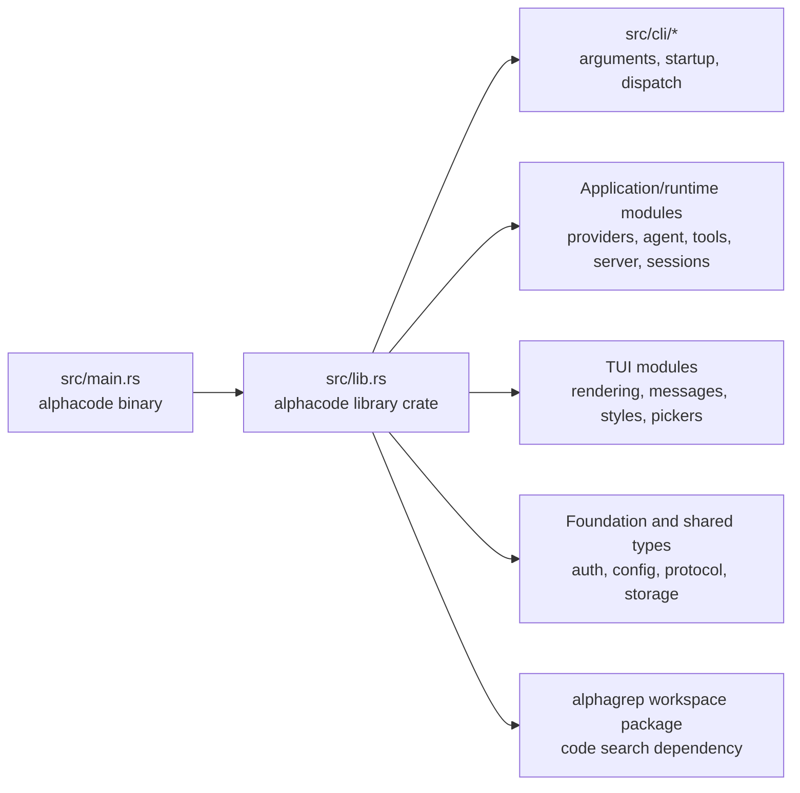
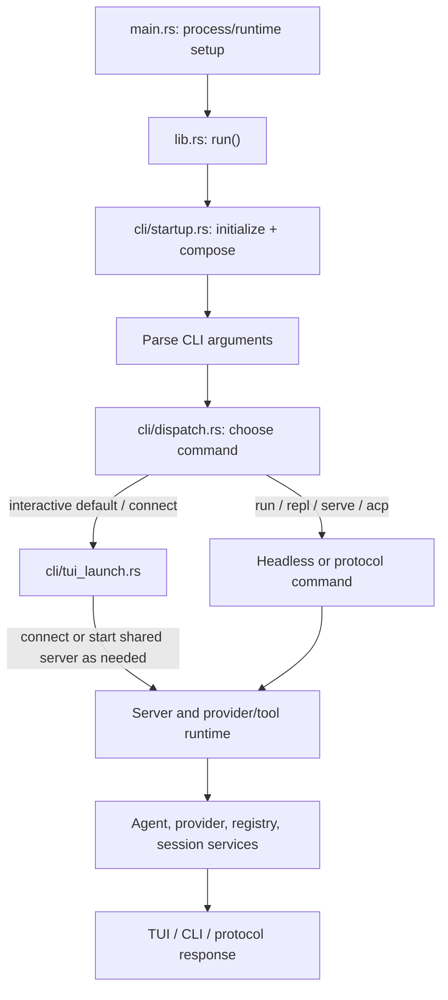

# Architecture and contributor map

This document describes the checked-in Rust structure and the runtime composition visible in source. It is a contributor map, not a claim that every module is exercised by every invocation. Build features, platform gates, CLI command selection, configuration, runtime registration, and external integrations all affect reachability.

## Workspace shape

The root `Cargo.toml` defines the `alphacode` package (both library and binary) and the workspace also includes the `alphagrep` package. The many `src/alphacode_*` names are Rust modules in the `alphacode` crate, not separate Cargo packages. The `src/lib.rs` comments explain that earlier crate layers were consolidated into this crate while preserving nested module names and public re-exports.

The diagram is intentionally at package/module level. It does not mean each dependency arrow is a direct Rust import or that every feature is compiled into every build.

## Process and request flow

`src/main.rs` sets up platform-specific process/runtime details and calls `alphacode::run()`. The library delegates to `cli::startup::run()`, which initializes cross-cutting services, registers implementations and callbacks whose concrete types live in higher-level modules, parses the CLI arguments, then calls `cli::dispatch::run_main()`.

The interactive client and non-interactive commands share application services, but they are not one identical UI path. `dispatch.rs` routes `run`, `repl`, `serve`, `acp`, `connect`, and the no-subcommand default separately. Follow the selected command and its configuration before assuming a module is reachable.

Startup is also a composition root: `startup.rs` registers provider runtimes and connects callbacks across otherwise separate modules (for example, config reload, permission notification, memory/skill metadata, session-list invalidation, and server spawning). These runtime registrations are meaningful edges that a static import-only graph may not represent.

## Where to make a change

| Concern | Start here | Notes |
|---|---|---|
| Binary entrypoint and process setup | `src/main.rs` | Platform-specific main-thread and runtime setup live here. |
| Public library entrypoint and module exports | `src/lib.rs` | Declares the consolidated crate's modules and re-exports. |
| CLI argument definitions | `src/cli/args.rs` | Commands and options; verify command handling in dispatch too. |
| Startup and cross-module wiring | `src/cli/startup.rs` | Initialization order, callback registration, provider runtime composition. |
| CLI command routing | `src/cli/dispatch.rs` | Headless commands, default interactive path, server/client launch. |
| TUI client launch | `src/cli/tui_launch.rs` | Client-side connection and terminal launch behavior. |
| Provider and tool registration | `src/cli/provider_init.rs`, `src/alphacode_app_core/tool/` | Inspect build/feature gates and runtime tool filters as well as registration. |
| Agent, protocol, server, sessions | `src/alphacode_agent_runtime/`, `src/alphacode_protocol/`, `src/server.rs`, `src/session.rs` | Shared runtime areas; trace callers for the specific command. |
| TUI rendering and interaction | `src/alphacode_tui/`, `src/alphacode_tui_*/` | Rendering, widgets and presentation modules; the source of truth is the concrete module and its callers. |
| Security/investigation workflows | `src/alphacode_security_core/` | Typed domain state and validation; check how CLI/TUI/session layers call it. |
| Code-search package | `alphagrep/` | Separate workspace package used by the main crate. |

Some paths may be gated by Cargo features or target platform. When documentation and implementation diverge, treat `Cargo.toml`, `src/lib.rs`, and the selected call path as authoritative and update this map with the change.

## Reading architecture graphs responsibly

Repository graph tools are useful navigation aids, not a proof of reachability or malware. A sampled or import-derived graph can omit runtime registries, trait objects, callbacks, generated/conditional code, platform gates, plugin/MCP discovery, and IPC boundaries. It can also flag tests, examples, fixtures, configuration, dead code, or unreachable helpers. Confirm an apparent disconnected node by tracing its definitions, registration sites, callers, features, and command/runtime entrypoints. Likewise, a graph-level risk score is a lead for review, not a security finding.

## Validation expectations

For code changes, run the narrowest relevant test first, then formatting and workspace checks. Changes to command dispatch, provider/tool registry, session protocol, or TUI behavior should include focused regression tests where feasible. A successful compile is not evidence that terminal rendering, keyboard interaction, platform-specific branches, or a release package behaves correctly; validate those separately when they are in scope.